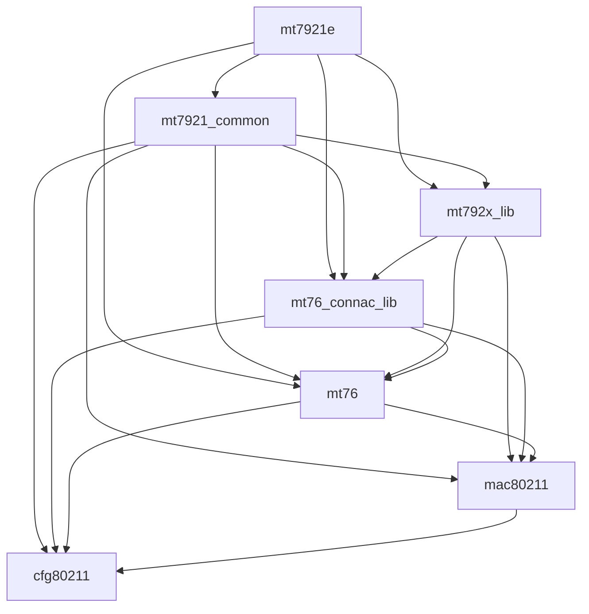

# Notes

## Rust for Linux のビルド

### 全体の流れ

```
./Makefile
  └ make -C $KDIR M=$PWD Mo=$OUT
    │ -C $KDIR: カーネルのビルドディレクトリの Makefile を実行する
    │ M=$PWD: 「外部モジュールを $PWD でビルドする」ことを指定（KBUILD_EXTMOD）
    │ MO=$OUT: 生成物を出力するディレクトリを指定（Kernel 6.13以降の方法）
    ▼
  $KDIR/Makefile
    │ M=... があると、デフォルトターゲットが modules になる
    ▼
  scripts/Makefile.build obj=. : ここで ./Kbuild が include される
    ▼
  scripts/Makefile.modfinal : .ko の仕上げ
```

 - scripts/Makefile.build が、対象ディレクトリ（`M=$PWD`で指定したディレクトリ）に `Kbuild`
   があればそれを、なければ `Makefile` を include する。 `Kbuild` が優先されるため、 `Makefile`
   はカーネルのビルド中には読まれない。そのため、 `Makefile` は人間用の入り口で、 `Kbuild` は
   カーネルのビルドシステムの入り口という役割分担となる。

 - 成果物は `M=...` で指定したディレクトリに出力される。 `-C` でディレクトリを移動するため、 
   `M=...` には絶対パスを指定する必要がある。

### Kbuild

``` bash
# SPDX-License-Identifier: GPL-2.0

obj-m := rust_out_of_tree.o
```

 - `obj-m` に指定したモジュールが作成される。
 - `obj-m := foo.o` で `foo.ko` を作る。その元は `foo.o` であるという記述方法で、
   `.o` ファイルは `.c` からも `.rs` からも作成できる。 kbuild はファイルの拡張子を見て、
   `.rs` の拡張子であれば rustc のルールを適応する。
 - Rust では `foo.rs` に `mod bar` を記述することで、 `bar.rs` が自動で読み込まれる。
   そのため、 `obj-m` の指定は `foo.o` だけで良い。
 - 別のモジュールを作る場合は、 `obj-m += hoge.o` と追加していく。

#### 複合オブジェクト指定

``` bash
# SPDX-License-Identifier: GPL-2.0

obj-m := mt76r.o        # mt76.ko というモジュールを作る
mt76r-y := src/lib.o    # mt76.o はsrc/lib.o から作る
```

 - `<name>-y` には、そのモジュールを構成するオブジェクトファイルを列挙する。
   kbuild はこれらを順番にビルドし、 `ld -r` で1つのモジュールにリンクして、`.ko` に仕上げる。
 - `mt76r.rs` や `mt76r.c` など、同名のソースコードがある場合は、 `-y` を書かなくても単体でビルドされる。
   `-y` を書くのは、元になるファイルの名前がモジュール名と違う場合や、複数ファイルから作る場合である。

#### Tips

`CONFIG_...` と組み合わせて、特定の `CONFIG_...` が有効（=y）のときだけソースコードを追加するという方法ができる。

``` Makefile
# CONFIG_FOO_DEBUG=y のとき、 foo-y に展開され、 kbuild からリンクされる
foo-$(CONFIG_FOO_DEBUG) += debug.o
```

---

### Rust for Linux out-of-tree モジュールのビルド問題メモ

**環境**: Ubuntu、カーネル `7.0.0-38-generic`
(gcc 15.2 でビルド、rustc 1.93.1、bindgen 0.72.1)

#### 最終的に通ったコマンド

```bash
sudo apt install linux-lib-rust-$(uname -r) rustc-1.93
make KDIR=/lib/modules/$(uname -r)/build RUSTC=/usr/bin/rustc-1.93
```

#### 問題と原因・解決

| # | エラー | 原因 | 解決 |
|---|---|---|---|
| 1 | `rustc-abi: invalid rustc abi: 'x86-softfloat'` | デフォルトの rustup rustc (1.99.1) が新しすぎる。ヘッダの target.json は旧名 `x86-softfloat` を出力するが、新しい rustc では `softfloat` に変更されている | カーネルをビルドした rustc に合わせる |
| 2 | `E0463: can't find crate for core` | `build/rust` が壊れたシンボリックリンクだった。Ubuntu はビルド済みの `rust/` 成果物 (libcore.rmeta など) を別パッケージに分けている | `sudo apt install linux-lib-rust-$(uname -r)` |
| 3 | `E0514: found crate core compiled by an incompatible version of rustc` | rmeta は rustc のバージョン文字列が完全一致しないと読めない。rustup の 1.93.1 は同じコミットでも `(built from a source tarball)` が付かず不一致 | apt 版 `rustc-1.93` を入れ、`RUSTC=/usr/bin/rustc-1.93` を指定 |
| 4 | clang: `unknown argument: '-mpreferred-stack-boundary=3'` など | カーネルは gcc でビルドされており、CFLAGS に gcc 専用オプションが入っている。`LLVM=1` で clang を使うと拒否される | `LLVM=1` を外す |

#### 確認に使ったコマンド

```bash
# カーネルをビルドした rustc / bindgen
grep -E 'RUSTC_VERSION_TEXT|BINDGEN' /lib/modules/$(uname -r)/build/include/config/auto.conf

# rust/ の中身 (リンク切れの確認)
readlink -f /lib/modules/$(uname -r)/build/rust
```

#### 教訓

- out-of-tree の Rust ビルドでは、**カーネルをビルドした rustc と完全に同じ rustc** が必要 (rustup 版では不可)。
- **カーネルをビルドしたコンパイラ (gcc/clang) に合わせる**。Ubuntu のカーネルなら gcc なので `LLVM=1` は付けない。
- `RUST_LIB_SRC` や `rust-src` は、`rust/` がビルド済みの out-of-tree では不要。

---

## 01-environment.md

### 0.1 PCI デバイスを確認

```bash
$ lspci -nnk
...
06:00.0 Network controller [0280]: MEDIATEK Corp. MT7922 802.11ax PCI Express Wireless Network Adapter [14c3:0616]
        Subsystem: Foxconn International, Inc. Device [105b:e0db]
        Kernel driver in use: mt7921e
        Kernel modules: mt7921e
...
```

#### バス番号

`06:00.0` の `06` の部分（`:` の前の番号）。16進数で 00~ff までの値を取る。
`バス(Bus)` とは、CPU、メモリ、GPU、ストレージなど、コンピュータ内部の各部品を接続し、
データのやり取りを行う共通の伝送路のこと。

#### デバイス番号

`06:00.0` の `00` の部分（`:` と `.` の間の番号）。16進数で 00~1f までの値を取る。
バス上のスロットやデバイスを示す番号。

#### ファンクション番号

`06:00.0` の `0` の部分（`.` の後の番号）。0~7の値を取る。
1つのデバイスが複数の機能（例えば、サウンドとネットワークの統合カードなど）を持つ場合、それらを区別するための番号。

#### デバイスクラス

`Network controller [0280]` の部分。どんなデバイスなのかの種類を示す。
`[0280]` はデバイスクラスコードと呼ばれ、4桁の16進数で分類される。

例:
 - 0000: Non-VGA unclassified device (非VGA非クラスデバイス)
 - 0108: Non-Volatile memory controller (不揮発性メモリコントローラ)
 - 0200: Ethernet controller (イーサネットコントローラ)

#### ベンダー

`MEDIATEC Corp.` の部分。`[14c3:0616]` の `14c3` (`:` の前の番号) がベンダーコードに当たり、16進数の値となる。

#### 名前

`MT7922 802.11ax PCI Express Wireless Network Adapter` の部分。

#### デバイスID

`[14c3:0616]` の `0616` の部分（`:` の後の番号）。

#### サブシステム

`Subsystem: Foxconn International, Inc. Device [105b:e0db]` の部分。 デバイスが搭載されているマザーボードやノートPCなどのホストシステムのベンダー名とモデル名を示す。

#### Kernel driver in use / Kernel modules

指定された PCI デバイスを制御しているカーネルドライバの名前を示す。

 - Kernel driver in use: 実際にデバイスにバインドされ、使用中のドライバ名
 - Kernel modules: そのデバイスをサポートするためにロード可能、利用可能なカーネルモジュールのリスト

#### 情報まとめ

 - Vendor ID: `14c3`
 - Device ID: `0616`
 - Subsystem Vendor ID: `105b`
 - Subsystem Device ID: `e0db`
 - Kernel driver in use: `mt7921e`
 - Kernel modules: `mt7921e`

---

### 0.2 PCI resource

```bash
$ lspci -vv -s 06:00.0
06:00.0 Network controller: MEDIATEK Corp. MT7922 802.11ax PCI Express Wireless Network Adapter
        Subsystem: Foxconn International, Inc. Device e0db
        Control: I/O- Mem+ BusMaster+ SpecCycle- MemWINV- VGASnoop- ParErr- Stepping- SERR- FastB2B- DisINTx+
        Status: Cap+ 66MHz- UDF- FastB2B- ParErr- DEVSEL=fast >TAbort- <TAbort- <MAbort- >SERR- <PERR- INTx-
        Latency: 0, Cache Line Size: 64 bytes
        Interrupt: pin A routed to IRQ 201
        IOMMU group: 19
        Region 0: Memory at 4202100000 (64-bit, prefetchable) [size=1M]
        Region 2: Memory at 85100000 (64-bit, non-prefetchable) [size=32K]
        Capabilities: <access denied>
        Kernel driver in use: mt7921e
        Kernel modules: mt7921e
```

#### Control

PCI 仕様上の `Command Register (Offset 0x04)` の内容。

```
Control: I/O- Mem+ BusMaster+ SpecCycle- MemWINV- VGASnoop- ParErr- Stepping- SERR- FastB2B- DisINTx+
```

| フラグ | 意味 | `+` / `-` の読み方 | 
| ----- | ---- | ---------------- |
| I/O | I/O ポート空間への応答の許可 | `+` : 許可、 `-` : 禁止 |
| Mem | メモリ空間への応答の許可 | `+` : 許可、 `-` : 禁止 |
| BusMaster | デバイスがバスマスター（DMA でバスを主体的に制御できる）として動作することの許可 | `+` : 許可、 `-` : 禁止 |
| SpecCycle | 特殊サイクルへの応答の許可 | `+` : 許可、 `-` : 禁止 |
| MemWINV | メモリ書き込み・無効化トランザクションの許可 | `+` : 許可、 `-` : 禁止 |
| VGASnoop | VGAパレットのスヌーピングの有効化 | `+` : 有効、 `-` : 無効 |
| ParErr | パリティエラー応答の有効化 | `+` : 有効、 `-` : 無効 |
| Stepping | アドレス / データのステッピングの有効化 | `+` : 有効、 `-` : 無効 |
| SEER | SERR# によるシステムエラー通知の有効化 | `+` : 有効、 `-` : 無効 |
| FastB2B | Fast Back-to-Back トランザクションの許可 | `+` : 許可、 `-` : 禁止 |
| DisINTx | INTx（ピン割り込み）の無効化 | `+` : 無効化、 `-` : 無効化していない |

 - DMA: `Direct Memory Access` は、CPUを介さずにデバイスとメモリ感でデータを直接転送する仕組み。これにより、CPUの負荷を軽減しつつ高速かつ大量のデータ転送が可能になる。現代のデバイスドライバは、 `Linux DMA Subsystem` や `DMA Engine Framework` といったカーネル内の抽象化レイヤを通じて、IOMMU やキャッシュコピーレンシを管理しながら DMA 操作を行う。
 - SERR#: PCI および PCI Express 規格において、システムレベルの致命的なエラーが発生したことを CPU やチップセットに通知するための非マスク可能割り込み（NMI）信号。
 - FastB2B: PCI バスなどのコンピュータバスにおいて、アイドルサイクル（待機状態）を省略して連続したデータ転送を行う技術仕様。
 
#### Status

PCI 仕様上の `Command Register (Offset 0x06)` の内容。

```
Status: Cap+ 66MHz- UDF- FastB2B- ParErr- DEVSEL=fast >TAbort- <TAbort- <MAbort- >SERR- <PERR- INTx-
```

| フラグ | 意味 |
| ----- | ---- |
| Cap | Capabilities レジスタが存在するかどうか |
| 66MHz | 66MHz 動作に対応しているかどうか (従来PCI向け) |
| UDF | User-Definable Features 機能に対応しているかどうか (従来PCI向け) |
| FastB2B | Bast Back-to-Back トランザクションに対応いているかどうか (従来PCI向け) |
| ParErr | パリティエラーが検出されたことを示すステータス |
| DEVSEL=fast | デバイスがアドレス選択時に応答するタイミングの設定 |
| >TAbort | デバイスがトランザクションを中止したかどうか |
| <TAbort | 他のデバイスからトランザクションを中止されたかどうか |
| <MAbort | 他のデバイスから Master Abort を検出したかどうか |
| >SERR | システムエラーを通知したことを示すステータス |
| <PERR | パリティエラーを検出したことを示すステータス |
| INTx | INTx 割り込みが保留中であることを示す |

#### Latency / Cache Line

```
Latency: 0, Cache Line Size: 64 bytes
```

| 項目 | 意味 |
| --- | --- |
| Latency | 従来 PCI のLatency Timer。 バス占有に関係する設定値。 |
| Cache Line Size | 従来　PCI の Cache Line Size フィールド。単位は 32-bit ワード。 |

#### Interrupt

```
Interrupt: pin A routed to IRQ 201
```

 - INTx 割り込みピンの情報と、Linux が認識している IRQ 番号

#### IOMMU group

```
IOMMU group: 19
```

`IOMMU` は、デバイスが　DMA でアクセスできるメモリ範囲を制御する仕組み。
`IOMMU group` は、IOMMU による隔離を考える際の単位。

グループの構成は、次のコマンドで確認できる。

```bash
ls -l /sys/kernel/iommu_groups/<N>/devices/
```

#### Region (BAR: Base Address Register)

```
Region 0: Memory at 4202100000 (64-bit, prefetchable) [size=1M]
Region 2: Memory at 85100000 (64-bit, non-prefetchable) [size=32K]   
```

| 項目 | Region 0 | Region 2 |
| --- | --------- | -------- |
| 物理アドレス | 0x4202100000 | 0x85100000 |
| 幅 | 64-bit | 64-bit |
| 属性 | prefetchable | non-prefetchable |
| サイズ | 1MiB | 32KiB |

 - Region 番号が 0 -> 2 と飛んでいるのは、 64-bit BAR は2つの 32-bit BAR レジスタを消費するため。
   Region 1 は Region 0 の上位 32 ビットに使用され、独立したリソースではない。
 - prefetchable : メモリ読み取りを先読みしたり、複数のアクセスをまとめたありしても、デバイスが提供するデータの意味が変わらない性質を表す。通常は大きなバッファやFIFO、フレームバッファで使用される。
 - non-prefetchable : 制御レジスタのように読み取り自体に副作用があったり、アクセスのたびに値が変化したりなどで、先読みが不適切な領域。

---
 
### 0.3 既存ドライバ

#### modinfo

```bash
$ modinfo mt7921e
filename:       /lib/modules/7.0.0-38-generic/kernel/drivers/net/wireless/mediatek/mt76/mt7921/mt7921e.ko.zst
license:        Dual BSD/GPL
description:    MediaTek MT7921E (PCIe) wireless driver
author:         Lorenzo Bianconi <lorenzo@kernel.org>
author:         Sean Wang <sean.wang@mediatek.com>
firmware:       mediatek/WIFI_MT7922_patch_mcu_1_1_hdr.bin
firmware:       mediatek/WIFI_RAM_CODE_MT7922_1.bin
firmware:       mediatek/WIFI_MT7961_patch_mcu_1_2_hdr.bin
firmware:       mediatek/WIFI_RAM_CODE_MT7961_1.bin
firmware:       mediatek/WIFI_MT7961_patch_mcu_1a_2_hdr.bin
firmware:       mediatek/WIFI_RAM_CODE_MT7961_1a.bin
srcversion:     5DD510B72B6C96B8A78E227
alias:          pci:v000014C3d00007920sv*sd*bc*sc*i*
alias:          pci:v000014C3d00000616sv*sd*bc*sc*i*
alias:          pci:v000014C3d00000608sv*sd*bc*sc*i*
alias:          pci:v00000B48d00007922sv*sd*bc*sc*i*
alias:          pci:v000014C3d00007922sv*sd*bc*sc*i*
alias:          pci:v000014C3d00007961sv*sd*bc*sc*i*
depends:        mt76-connac-lib,mt7921-common,mt792x-lib,mt76
intree:         Y
name:           mt7921e
retpoline:      Y
vermagic:       7.0.0-38-generic SMP preempt mod_unload modversions
sig_id:         PKCS#7
signer:         Build time autogenerated kernel key
sig_key:        3B:E7:D3:BF:D3:2E:D9:CA:9C:17:D2:E9:5F:1A:1C:AE:67:D5:82:2F
sig_hashalgo:   sha512
signature:      39:21:ED:BA:F4:E5:3B:6D:DE:4D:06:23:9F:9D:76:D3:02:10:5E:9B:
                8D:99:7F:CA:A5:CF:9C:23:00:C9:10:E2:43:2D:09:E4:41:05:BF:50:
                35:E4:B4:BA:CF:A9:AB:48:43:13:5D:15:D6:F1:50:95:27:29:97:B0:
                91:17:89:02:83:C1:3E:0E:FF:92:9A:10:3B:3B:85:A5:DA:1F:60:59:
                BF:90:E9:C1:59:4C:F2:4E:D5:AE:37:B1:EE:37:A8:17:42:CD:25:42:
                EE:74:BE:B5:29:95:A4:4A:1A:16:DA:66:75:19:2F:5E:9A:DF:80:A7:
                25:81:38:13:CA:76:5E:A8:63:11:5D:21:1A:95:C7:3C:2E:C9:DD:3E:
                E3:88:99:35:4E:F1:5F:D9:81:6F:5D:5D:CC:E4:3B:AE:B2:23:07:CA:
                37:5A:5B:4E:71:51:A2:D1:61:DD:62:BB:36:EF:34:76:92:5C:70:87:
                DA:7A:7A:B1:5F:7D:B9:24:A4:C1:4D:06:F4:72:F4:17:0F:1D:D5:DE:
                5D:DA:09:CF:B5:C5:D2:D9:2C:7C:D9:9A:9A:AC:4B:E9:B8:C6:2B:A0:
                A4:6A:03:B6:B6:AB:6F:13:B2:E0:82:AA:B1:49:95:8A:17:68:54:1C:
                55:51:A7:13:A5:2F:2F:7D:3C:8E:C2:0D:90:08:41:61:B5:D3:0A:08:
                B8:2C:3D:12:A0:F6:95:DB:3C:C8:35:7C:01:A0:E9:ED:6C:6B:9E:D3:
                02:07:C8:C3:04:A9:B6:AB:75:67:74:F5:EF:26:3F:75:52:F7:9C:01:
                7F:53:DF:5A:B7:55:E4:0A:E0:58:EE:98:F1:42:A0:63:E0:EB:95:DE:
                02:AD:7A:80:79:A0:29:BB:BC:BA:BF:9C:33:5A:EE:BB:1E:35:EC:98:
                21:8E:15:23:4B:F2:13:C1:D4:F7:5D:B3:FE:B2:8D:D6:5D:C4:CD:46:
                04:CB:52:5B:8E:C7:56:34:12:53:92:FF:12:6C:B4:01:7D:95:D6:4B:
                59:9C:34:EC:3A:46:57:C8:EF:E5:AC:04:13:59:5F:AB:00:1D:BE:3F:
                0F:78:FA:ED:DD:68:99:B8:F2:5F:DA:8F:2D:FA:4D:E8:AD:B0:4D:F5:
                A6:E1:E8:B0:B5:6C:33:D2:18:42:80:AB:AE:1C:FF:25:B3:F4:72:FF:
                02:0C:A7:C8:03:94:E2:B7:35:3A:27:A5:12:87:9E:1A:F9:B3:E4:80:
                61:7F:82:FE:46:27:CB:C5:75:90:F3:7A:7E:F7:11:EF:BB:7C:F4:66:
                65:F2:69:10:2C:61:EE:BD:5D:F4:15:3D:74:FA:0F:4F:8C:33:F3:C2:
                61:DC:00:25:07:85:B4:09:7B:DB:48:68
parm:           disable_aspm:disable PCI ASPM support (bool)
```

| 項目 | 意味 |
| --- | ---- |
| filename | モジュールファイルのパス |
| license | ライセンス |
| description | ドライバの説明 |
| author | 作者情報 |
| firmware | ドライバがカーネルのファームウェアローダーを通じて要求するファイル名 |
| srcversion | ソース由来の識別情報. ビルド対象ソースなどの変更検知に使われる. |
| alias | どの PCI デバイスに対応するか. PCI デバイスの識別情報と、ドライバを自動ロードするための対応関係を表している. |
| depends | 依存するカーネルモジュール |
| intree | カーネル本体のソースツリー内でビルドされたかどうか |
| name | カーネルモジュール名 |
| retpoline | retpoline 対応情報 |
| vermagic | カーネルとの互換性情報 |
| sig_id | 署名形式の識別情報 |
| signer | 署名者として記録された名前 |
| sig_key | 署名鍵を識別するための情報 |
| sig_hashalgo | 署名に仕様されたハッシュアルゴリズム |
| signature | 電子署名のデータ |
| parm | モジュールパラメータ |

##### filename

> /lib/modules/7.0.0-38-generic/kernel/drivers/net/wireless/mediatek/mt76/mt7921/mt7921e.ko.zst

 - mt7921e.ko : カーネルモジュール本体
 - .zst : Zstandard 形式で圧縮されている

##### alias

```
pci:v000014C3d00007920sv*sd*bc*sc*i*
pci:v000014C3d00000616sv*sd*bc*sc*i*
pci:v000014C3d00000608sv*sd*bc*sc*i*
pci:v00000B48d00007922sv*sd*bc*sc*i*
pci:v000014C3d00007922sv*sd*bc*sc*i*
pci:v000014C3d00007961sv*sd*bc*sc*i*
```

| フィールド | 意味 |
| -------- | ---- |
| pci: | PCI デバイス向けの alias |
| v000014C3 | Vendor ID = `0x14C3` |
| d00007920 | Device ID = `0x7920` |
| sv* | Subsystem Vendor ID は任意 (ワイルドカード `*` ) |
| sd* | Subsystem Device ID は任意 (ワイルドカード `*`) |
| bc* | Base Class は任意 (ワイルドカード `*`) |
| sc* | Subclass は任意 (ワイルドカード `*`) |
| i* | Programming Interface は任意 (ワイルドカード `*`) |

PCI デバイスには Vendor ID や Device ID だけでなく、そのデバイスが何をする装置なのかを表す `Class Code` が存在する。Class Code は 24 bit で、3つに分かれている。

```
PCI Class Code (24bits)
+--- 8 bit ---+  +--- 8 bit ---+  +-------- 8 bit --------+
| Base Class  |  |  Subclass   |  | Programming Interface |
+-------------+  +-------------+  +-----------------------+
```

 - Base Class : 基本クラス。例えばネットワークコントローラ、ストレージコントローラ、ディスプレイコントローラなど。
 - Subclass : 大分類の中での種類。例えばストレージコントローラなら、 SATA や NVMe などの分類。
 - Programming Interface : その分類の中で、特定のレジスタインターフェースなどを識別するための値。該当する標準的な区別がない場合は、`0x00` などになることもある。

例: USB コントローラ

例えば、 PCI Class Code が `0x0C0330` なら、次のように解釈できる。

| フィールド | 値 | 意味 |
| -------- | -- | --- |
| Base Class | 0x0C | Serial Bus Controller |
| Subclass | 0x03 | USB Controller |
| Programming Interface | 0x30| xHCI |

##### firmware

```
mediatek/WIFI_MT7922_patch_mcu_1_1_hdr.bin
mediatek/WIFI_RAM_CODE_MT7922_1.bin
mediatek/WIFI_MT7961_patch_mcu_1_2_hdr.bin
mediatek/WIFI_RAM_CODE_MT7961_1.bin
mediatek/WIFI_MT7961_patch_mcu_1a_2_hdr.bin
mediatek/WIFI_RAM_CODE_MT7961_1a.bin
```

MT7922関連では、特に次の2ファイルが重要。

| ファイル | 大まかな役割 |
| ------- | ---------- |
| WIFI_MT7922_patch_mcu_1_1_hdr.bin | MCU 用パッチファームウェア |
| WIFI_RAM_CORE_MT7922_1.bin | RAM にロードするファームウェアコード |

Linux では、一般に `/lib/firmware/` 以下からファイルが検索される。
ただし、実ファイルが `.bin.zst` 形式で圧縮されている場合もある。

```
$ fd MT7922 /lib/firmware/
/lib/firmware/mediatek/BT_RAM_CODE_MT7922_1_1_hdr.bin.zst
/lib/firmware/mediatek/WIFI_MT7922_patch_mcu_1_1_hdr.bin.zst
/lib/firmware/mediatek/WIFI_RAM_CODE_MT7922_1.bin.zst
```

また、 modinfo にファームウェアが列挙されていても、全てが同時に必要という意味ではない。
複数チップを扱うドライバが、それぞれのファームウェア名を登録している場合がある。

実際にどのファイルが要求されたかは、カーネルログで確認できる。

```bash
$ sudo dmesg | rg -i firmware
...
[   11.077506] mt7921e 0000:06:00.0: WM Firmware Version: ____000000, Build Time: 20260224103233
...
```

##### depends

> mt76-connac-lib,mt7921-common,mt792x-lib,mt76

| モジュール | 大まかな役割 |
| -------- | ---------- |
| mt76-connac-lib | MT76 系の CONNAC 世代に関する共通処理 |
| mt7921-common | MT7921 系ドライバの共通処理 |
| mt792x-lib | MT792x 系ドライバの共通処理 |
| mt76 | MT76 ドライバ郡の共通処理 |

##### vermagic

> 7.0.0-38-generic SMP preempt mod_unload modversions

モジュールをどのようなカーネル構成向けにビルドしたかを示す。

| 値 | 意味 |
| -- | --- |
| 7.0.0-38-generic | 対象カーネルのリリース文字列 |
| SMP | 対象型マルチプロセッシング対応 |
| preempt | プリエンプション関連の構成情報 |
| mod_unload | モジュールのアンロード機能に関する構成情報 |
| modversions | モジュールのシンボルバージョン管理に関する構成情報 |

`vermagic` は、モジュールを異なるカーネルに誤ってロードすることを防ぐための互換性チェックに使われる。

##### license

カーネルはモジュールのライセンス文字列を参照し、GPL 専用シンボルの利用可否やカーネルの taint 状態などを判断する。、

##### parm

モジュールの動作を調整するパラメータ

> disable_aspm:disable PCI ASPM support (bool)

 - `disable_aspm` : PCIe の ASPM (Active State Power Management) を無効化するための設定
 - `bool`: 真偽値

> ASPM は、PCIe のリンクを省電力状態に行こうさせる仕組み。

例えば、ロード時に次のように指定できる

```bash
sudo modprobe mt7921e disable_aspm=1
```

この場合、パラメータを `true` に設定する。

すでにモジュールがロードされている場合は、ロード時の引数を変更するために、必要に応じてアンロード・リロードを行う。

現在のパラメータ値は、モジュールがロードされていれば次のように確認できる。

```bash
$ cat /sys/module/mt7921e/parameters/disable_aspm
N
```


##### retpoline

Spectre Variant 2 などへの対策に関係する retpoline 対応情報。

 - Spectre Variant 2 : CPU の「投機的実行」を悪用して、通常のプログラムからは直接読めない情報を推測させる攻撃に関係する脆弱性。
`if (A < B) { ... }` のようなコードがあったとき、CPU は `A < B` の結果が確定する前に、条件が成立すると予測して処理を進めることがある。
予測が外れれば、、CPU は通常、その処理の結果をアーキテクチャ上の状態に反映しないようにするが、投機的実行に実行された処理の影響がキャッシュなどに残る場合がある。攻撃者がその影響を観測できると、本来アクセスできない情報を推測できる場合がある。
Variant 2 では、CPU の間接分岐（関数ポインタなど、実行先のアドレスが実行時に決まる分岐）の予測を攻撃者が操作することで、CPUに意図しないコードを実行させることができる可能性がある。

 - retpoline : 攻撃者に操作されてた間接分岐予測を、そのまま実行先の予測に使わせないようにする仕組み。

##### 必要な情報だけを抽出する

`modinfo` は `-F` を使うと、指定した項目だけを表示できる。

```bash
$ modinfo mt7921e -F firmware
mediatek/WIFI_MT7922_patch_mcu_1_1_hdr.bin
mediatek/WIFI_RAM_CODE_MT7922_1.bin
mediatek/WIFI_MT7961_patch_mcu_1_2_hdr.bin
mediatek/WIFI_RAM_CODE_MT7961_1.bin
mediatek/WIFI_MT7961_patch_mcu_1a_2_hdr.bin
mediatek/WIFI_RAM_CODE_MT7961_1a.bin
```

#### lsmod

```bash
$ lsmod
Module                  Size  Used by
--------------------------------------------------------------------------------
...
mt7921e                24576  0
mt7921_common          94208  1 mt7921e
mt792x_lib             73728  2 mt7921e,mt7921_common
mt76_connac_lib       110592  3 mt792x_lib,mt7921e,mt7921_common
mt76                  167936  4 mt792x_lib,mt7921e,mt7921_common,mt76_connac_lib
mac80211             1937408  5 mt792x_lib,mt76,iwlmvm,mt7921_common,mt76_connac_lib
cfg80211             1548288  6 mt76,iwlmvm,iwlwifi,mac80211,mt7921_common,mt76_connac_lib
...
```



#### readlink

```bash
$ readlink /sys/bus/pci/devices/0000:06:00.0/driver
../../../../bus/pci/drivers/mt7921e
```

つまり、 `/sys/bus/pci/devices/0000:06:00.0/driver` --> `/sys/bus/pci/drivers/mt7921e` と接続。

```bash
$ ls /sys/bus/pci/drivers/mt7921e/
0000:06:00.0  bind  module  new_id  remove_id  uevent  unbind
```

 - `0000:06:00.0` はシンボリックリンク

```bash
$ ls -l /sys/bus/pci/drivers/mt7921e/
0000:06:00.0 -> ../../../../devices/pci0000:00/0000:00:1c.1/0000:06:00.0

$ ls /sys/devices/pci0000:00/0000:00:1c.1/0000:06:00.0/
aer                       current_link_speed  ieee80211       modalias     reset             subsystem_vendor
aer_dev_correctable       current_link_width  iommu           msi_bus      reset_method      uevent
aer_dev_fatal             d3cold_allowed      iommu_group     msi_irqs     resource          vendor
aer_dev_nonfatal          device              irq             net          resource0         wakeup
ari_enabled               dma_mask_bits       link            numa_node    resource0_wc
broken_parity_status      driver              local_cpulist   power        resource2
class                     driver_override     local_cpus      power_state  revision
config                    enable              max_link_speed  remove       subsystem
consistent_dma_mask_bits  firmware_node       max_link_width  rescan       subsystem_device
```

 - `module` はシンボリックリンク

```bash
$ ls -l /sys/bus/pci/drivers/mt7921e/
module -> ../../../../module/mt7921e

$ ls /sys/module/mt7921e/
coresize  holders   initstate  parameters  sections    taint
drivers   initsize  notes      refcnt      srcversion  uevent
```
---

### 0.4 最初の原則

既存 `mt7921e` が MT7922 を掴んでいるので、自作モジュールを insmod する際に MT7922 が mt7921e に掴まれていない状態にしないと、自作モジュールから MT7922 を操作できない。

これを解決するため、 `driver_override` という仕組みがある。

#### PCI ドライバ管理の流れ

Linux の PCI ドライバでは、基本的に次のような流れになる。

1. PCI デバイスが検出される
2. PCI ID が一致するドライバが検索される
3. ドライバの `probe()` が呼ばれる
4. `probe()` が成功すると、そのドライバがデバイスを管理する

既に `mt7921e` の `probe()` が成功している場合、自作ドライバをロードしても自動的に切り替わることはない。
そこで、既存ドライバからデバイスを解放し、自作ドライバに明示的に割り当てる。

#### driver_override の方法

`/sys/bus/pci/devices/$BDF` に `driver_override` がある。

```bash
$ ls -la  /sys/bus/pci/devices/0000:06:00.0/driver_override
.rw-r--r-- 4.1k root 29 10月 21:21 /sys/bus/pci/devices/0000:06:00.0/driver_override
$ cat /sys/bus/pci/devices/0000:06:00.0/driver_override
(null)
```

ここにオーバーライドさせたいモジュール名を記入することで、PCI ID による通常のマッチングを上書きできる。

```bash
echo mt76r | sudo tee /sys/bus/pci/devices/0000:06:00.0/driver_override
```

 - 指定した名前のドライバだけをバインド対象にする
 - 現在のドライバを自動的に解除するわけではない
 - 指定したドライバを自動的にロードするわけではない

すなわち、 `driver_override` に自作ドライバを登録しただけで、デバイスを使用できるというわけではない。

#### 自作モジュールからデバイスを使用する

以下の手順で行う。

1. デバイスの解放

> echo 0000:06:00.0 | sudo tee /sys/bus/pci/drivers/mt7921e/unbind

これで MT7922 が mt7921e から解放される

2. 自作モジュールのロード

> sudo insmod mt76r

3. デバイスをドライバにバインド

> echo 0000:06:00.0 | sudo tee /sys/bus/pci/drivers/mt76r/bind

これで自作ドライバの `probe()` が呼ばれる。

4. バインド状態の確認

> readlink /sys/bus/pci/devices/0000:06:00.0/driver

`mt7691e` の場合のように、`mt76r` への相対パスが表示されれば、バインドに成功している。

#### driver_override の解除方法

自作ドライバからデバイスを解放して、元のドライバに戻す場合は次のようにする。

```bash
# 自作ドライバから解放
echo 0000:06:00.0 | sudo tee /sys/bus/pci/drivers/mt76r/unbind

# override を解除
echo "" | sudo tee /sys/bus/pci/devices/0000:06:00.0/driver_override

# 元のドライバに再バインド
echo 0000:06:00.0 | sudo tee /sys/bus/pci/drivers/mt7921e/bind
```

---
